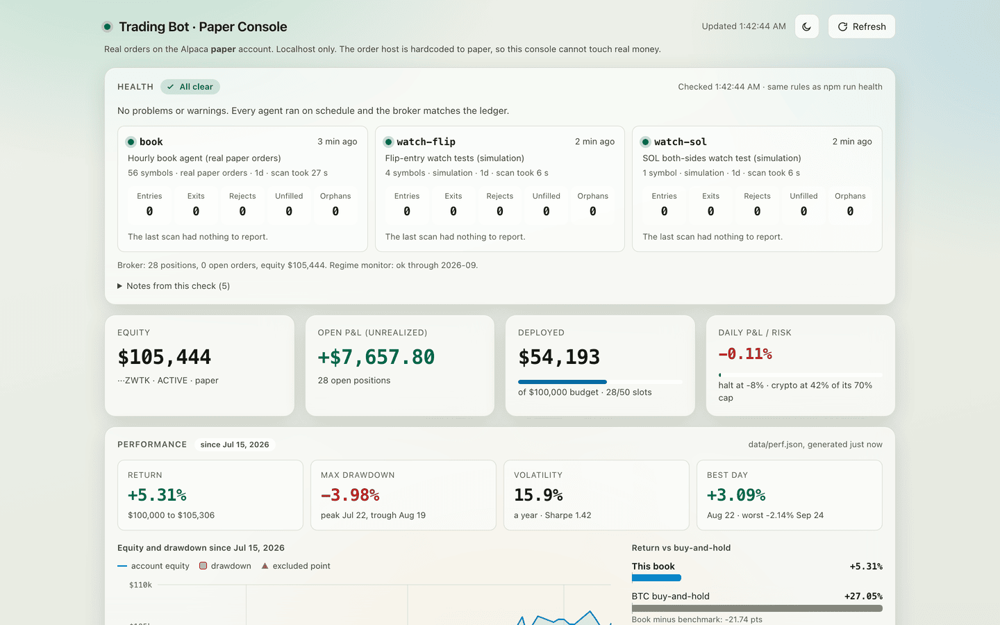

# trading-harness

[](https://github.com/jke48222/trading-harness/actions/workflows/ci.yml) [](LICENSE)  

A research harness for testing whether a small trading bot has a real edge, and an autonomous paper book that trades the one strategy that passed.

<sub>Paper money only. Orders can reach only Alpaca's paper host, which serves no live accounts. Not investment advice.</sub>

<picture>
  <source media="(prefers-color-scheme: dark)" srcset="docs/media/dashboard-dark.png">
  
</picture>

## What is it?

Each trial writes down its rules, data window and pass bar ahead of its results, and every configuration tried is logged to [`data/trials.csv`](data/trials.csv) (129 rows covering 68 distinct configurations). Each result is shown next to a Bonferroni correction for that count: Trial 07 survives it at 0.027 (0.021 against the 53 configurations disclosed when it ran), and the later crypto passes do not. Trials 08 to 11 show their registration before their results in git; Trials 01 to 07 entered the history with their results in the first commit, weeks after they ran. Three fast technical rules were rejected outright, five per-trade candidates failed a multiple-testing correction, and one portfolio construction passed (Trial 07). Trial 08 confirmed it at this account's real costs and found no support for the same rule on US stocks. Trial 09 replaced its single 28-day lookback with a four-lookback vote that trades a third less, and Trial 10 found no support for trend timing on asset-class ETFs either. Since July 2026 a set of launchd agents has traded it on a $100,000 Alpaca paper account, with every fill reconciled against the ledger.

## Results

| Trial | Question | Result |
|---|---|---|
| [01](docs/trial_01_ma_cross.md) | 9/21 moving-average cross, BTCUSDT 5m | Rejected: out-of-sample profit factor 0.52 |
| [02](docs/trial_02_htf_regime_filter.md) | The same cross with a 1h trend filter | Rejected: profit factor 0.69 and 0.45 |
| [03](docs/trial_03_donchian_breakout.md) | Donchian-20 breakout, 1h | Rejected: 18 of 18 runs negative at 30 bps |
| [04](docs/trial_04_tsmom_daily.md) | 28-day time-series momentum (TSMOM), daily, per trade | 2 candidates |
| [05](docs/trial_05_tsmom_universe.md) | TSMOM on 9 more symbols | 3 more candidates; 2 set aside as market drift |
| [06](docs/trial_06_multiple_testing_correction.md) | Multiple-testing correction of 04 and 05 | All 5 candidates fail: p 0.22 to 0.42 |
| [07](docs/trial_07_portfolio_reanalysis.md) | TSMOM as an equal-weight portfolio of 8 unselected cryptos | **Pass:** +4.30% a month over its own average exposure, p = 0.0004; the 2023 to 2026 subsample alone is not significant |
| [08](docs/trial_08_cost_and_sleeves.md) | Trial 07 at this account's real costs, on the book's 32 coins, and on US equity ETFs | Crypto holds: +3.74% a month on Trial 07's coins and +2.99% on the book's 32, p = 0.0011 each. Stocks fail: -0.23% a month, negative before costs |
| [09](docs/trial_09_crypto_momentum_v2.md) | A vote across 7-, 14-, 28- and 56-day returns with a band between entry and exit, against the 28-day rule, 2021 to 2026 | **Pass:** +3.27% a month over its own average exposure, p = 0.010. It beat the 28-day rule by +0.37% a month (p = 0.15) and trades a third less, so the book switched |
| [10](docs/trial_10_cross_asset_trend.md) | Trend timing across 11 asset-class ETFs: stocks, bonds, gold, commodities, the dollar | Fails: -0.09% a month, p = 0.83. No trend sleeve |
| [11](docs/trial_11_combination.md) | The crypto book, an ETF trend sleeve and SPY mixed (descriptive) | Crypto and trend at equal risk: Sharpe 1.10 against 0.93 for crypto alone over the same months, worst drawdown 10% against 52% |

Trial 08 is why the book stopped opening stock positions on 2026-10-11 (`ENTRY_SKIP=@book-stocks`); the stocks it held then exit on the momentum rule. Over ten years, 28-day momentum timing on 15 unselected US equity ETFs, held in equal weights, lost to its own average exposure even before costs; at 5 bps every one of them lost. The paper book's stocks lost $1,869 over 66 round trips. The crypto result survived this account's real costs with room to spare: it breaks even at 162 to 193 bps per position change, and this account pays roughly 26 to 37 by the mean and median fills. Two cautions stand: the 2023 to 2026 era alone is not significant, and corrected for all 68 configurations tried, the crypto passes are not significant (Trial 08 at 0.075, Trial 09 at 0.69).

Since 2026-10-11 the book trades Trial 09's vote. Its lead over the 28-day rule is mostly lower costs: it changes a position 20 times a coin per year instead of 30. Trial 11 shows that pairing the crypto book with a low-correlation sleeve mostly cuts drawdowns. Trial 10 found that the ETF trend sleeve's help came from holding those assets, not timing them, so the book has no trend sleeve.

### The paper book

From 2026-07-15 to 2026-10-10 the paper account returned +5.3%, with a -4.0% maximum drawdown. Over the same days BTC returned +27.0%, SPY +3.8%, and the book's 56 symbols held in equal weights +23.6%. In a broad crypto rally, holding everything beat a strategy that historically sits in each coin about half the time, and the book was also short of crypto for most of the period because resting orders blocked its entries ([incident](docs/incidents.md)).

The execution itself is faithful. Across 108 closed round trips, fills differed from the model's gross return by a mean of -0.09% a trip (median -0.18%). Realized results split by sleeve, in cash before Alpaca's USD fees: stocks lost $1,869 over 66 trips and crypto $31 over 42. The crypto trips' share of the $199 in USD sell fees takes them to about -$220. Open crypto positions held about $6,700 of unrealized gains at 05:42 UTC on October 11, when the screenshot above was taken. `npm run report` and `npm run perf` reproduce these numbers.

## Get started

You need Node 20.6 or later. Market data for crypto is public; stock data, paper trading and the reports need [Alpaca paper keys](https://app.alpaca.markets/paper/dashboard/overview).

1. **Install:** `git clone https://github.com/jke48222/trading-harness && cd trading-harness && npm ci`
2. **Test:** `npm test` runs 137 tests with the broker and market data mocked.
3. **Replay a strategy on public data:** `npm run replay:raw`. Pick one with `STRATEGY`, `SYMBOL` and `INTERVAL`; every run is appended to `data/trials.csv`.
4. **Connect a paper account:** `cp .env.example .env` and set `ALPACA_PAPER_KEY_ID` and `ALPACA_PAPER_SECRET`. Then `npm run broker:check` reads the account without placing anything.
5. **Run the book:** `scripts/agents.sh install` loads the hourly book agent, the 30-minute health check and the monthly regime monitor on macOS. `scripts/agents.sh status` shows them; `uninstall` removes them. To keep the live ledger, heartbeats and logs out of the checkout, set `DATA_DIR` in `.env` (and `TRIALS_FILE=data/trials.csv` to keep the research record in it), then run `install` again.

## Commands

| Command | What it does |
|---|---|
| `npm run scan` | One decision cycle over `SYMBOLS`: score matured trades, manage exits, look for entries |
| `npm run report` | The book from broker fills: round trips by sleeve, model against actual, fees, per symbol |
| `npm run perf` | Account return (time-weighted, net of cash from outside the book), drawdown and volatility against BTC, SPY and an equal-weight hold of the universe |
| `npm run reconcile` | Rebuild round trips from broker fills and list where the ledger disagrees; `-- --apply` repairs what the fills prove |
| `npm run health` | Agents, open orders, positions, cash and the regime monitor; exits 2 on a problem it has posted, 1 if it could not post |
| `npm run positions` | Open paper positions and budget use |
| `npm run tsmom:monitor` | Recompute Trial 07's construction month by month and check the registered alarm |
| `npm run dashboard` | Local console at http://127.0.0.1:8787 |
| `npm run replay:raw` / `replay:memory` | Replay a strategy over recent history, without and with the memory filter |
| `npm run typecheck` / `npm test` | TypeScript check and the test suite |

## How it works

```
Binance / Alpaca bars ──> signal (closed candles only) ──> risk gates ──> order ──> settle ──> ledger
                                                                                     │
Alpaca fills ─────────────────────────────────────────> round trips ──> reconcile ───┘
```

- **Signals** use closed candles only, so they never repaint. The book runs Trial 09's vote: buy a coin when at least three of its 7-, 14-, 28- and 56-day returns are positive, sell when one or none are, and hold in between.
- **Risk gates** ([`src/portfolioRisk.ts`](src/portfolioRisk.ts)): an 8% daily-loss halt on new entries, volatility-scaled size, a 70% cap on crypto (it moves as one bet), a 30% catastrophe stop, and no pyramiding. A stopped or manually closed symbol is not bought back until its rule has said exit on a close since.
- **Orders** ([`src/broker/orders.ts`](src/broker/orders.ts)) are priced off the venue's own quote and rounded up to Alpaca's increment. A crypto entry is skipped when the spread is over 100 bps. Every order settles, filled, partly filled or canceled after 30 seconds, and a scan sweeps anything a crash left behind.
- **The ledger** (`ledger.csv` in `DATA_DIR`, by default `data/`) records every decision with a plain-English reason. Writes take a file lock, so two agents can't drop each other's rows.
- **Broker truth** ([`src/broker/fills.ts`](src/broker/fills.ts)): round trips are rebuilt from Alpaca's fills, which are the record of what traded. `reconcile` compares them with the ledger.
- **Health** reads a heartbeat from each agent and posts a macOS notification on refused or stuck orders, unattributed positions, failed exits or a silent agent. It measures silence in its own runs, so a sleeping Mac never pages, and a book agent silent across five health runs (about 2.5 awake hours) does. It also pages on cash from outside the book (a journal, deposit or withdrawal), on negative cash, and on broker cash the activity log can't account for.

The operating rules and the gates before any real money are in [`docs/paper_phase_protocol.md`](docs/paper_phase_protocol.md).

## Limits and known issues

- **Paper fills are not real fills.** On most pairs, Alpaca's paper engine fills marketable orders at once and fills a resting limit once the market reaches it, with no queue, so it flatters passive orders. Maker-fee savings can't be judged from paper fills.
- **Alpaca's paper engine never fills three of the book's coins.** It filled none of 42 orders on LDO, POL and WIF from July to October, market orders and limits above the ask alike, so the book takes no new entries in them and can open positions in at most 29 of its 32 coins ([incident](docs/incidents.md)). That is a fact about the paper engine; no live account was tested.
- **The book's sizing differs from the test.** Trial 07 tested equal weights; the book scales size down for volatile coins. That is a risk control, and its effect on returns is untested.
- **A cash journal the bot did not make left cash negative.** Alpaca's records show -$66,905.32 journaled out of the paper account on October 13, which its activity log does not list. Until it is resolved, the book can't open crypto positions; returns are measured net of it ([incident](docs/incidents.md)).
- **Crypto was under-deployed from July 27 to October 11.** Resting orders held back cash and blocked crypto entries on 48 days ([incident write-up](docs/incidents.md)). Results from that period understate the crypto positions the strategy called for.
- **launchd pauses while the Mac sleeps**, so the book misses scans until it wakes. Crypto entries only open in the two hours after the 00:00 UTC close, and health posts one notice a day when no scan ran in that window.
- **Stock exits wait for the open**, and go in at the first scan after 9:30 ET, up to an hour later.
- **Trial 07's recent era is not significant on its own** (2023-12 onward, p = 0.23). The monthly monitor watches for the registered alarm, a negative trailing-12-month excess. It tracks Trial 07's 28-day construction, the one the alarm was registered on, not the book's vote.

## Project layout

```
src/            bot, strategy, risk, scoring, reports, health, dashboard server
src/broker/     Alpaca paper adapter (orders, fills, reconcile)
scripts/        trial analyses, the regime monitor, scripts/agents.sh
docs/           trial pre-registrations and results, protocol, incidents
data/           trials.csv (the research record), and the ledger, lessons and monitor
                output as of 2026-10-11 (the live copies are in DATA_DIR)
ops/launchd/    the agents' plist templates
test/           node:test suites
```

## Credits and license

The first build followed the "Paper Trading Bot Prompts" guide from Miles High Club ([details](docs/prompt_sequence.md)). MIT, see [LICENSE](LICENSE). Not affiliated with Alpaca, Binance or TradingView.
